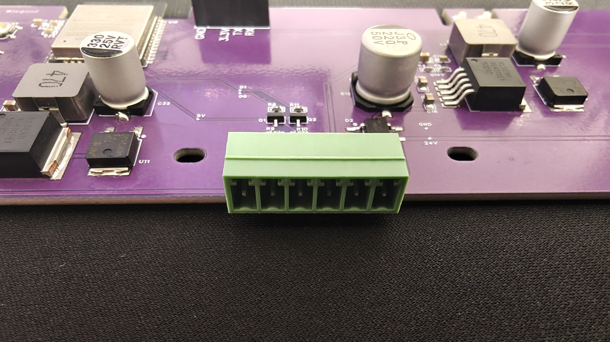
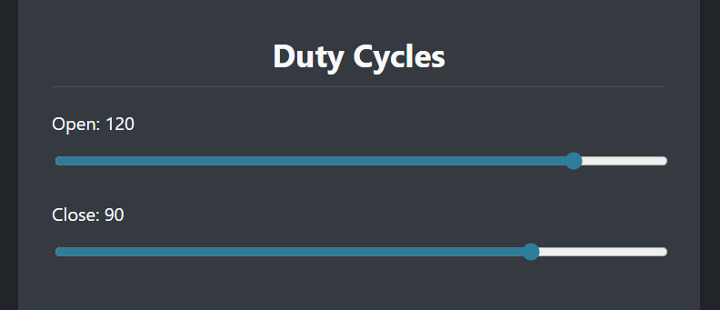
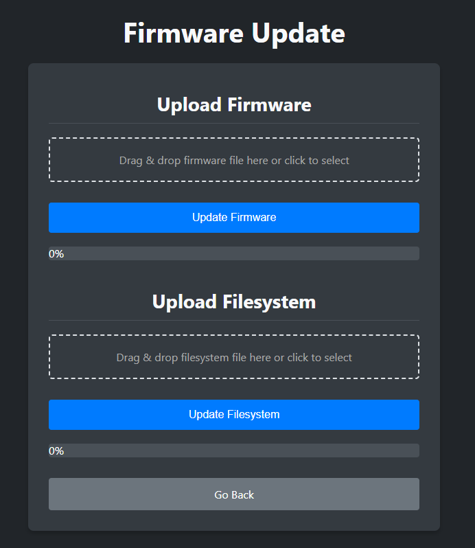
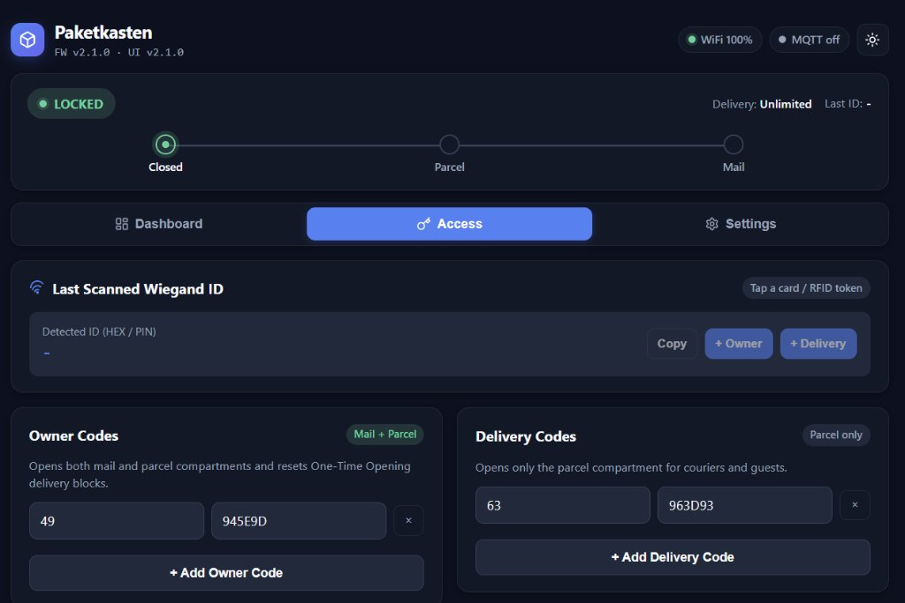

# Projektbeschreibung

Dieses Projekt ist ein Paketkasten-System, das die sichere und effiziente Zustellung von Paketen ermöglicht. Es integriert ein Wiegand-Keypad für den Zugang und ist für den Betrieb mit einer Gleichstromversorgung von 14-36V ausgelegt.

## Inhaltsverzeichnis

- [Mainboard tauschen](#mainboard-tauschen)
- [Pin-Beschreibung](#pin-beschreibung)
- [LED-Statusanzeigen](#led-statusanzeigen)
- [Duty Cycle](#duty-cycle)
- [MQTT-Integration](#mqtt-integration)
  - [MQTT-Status (Topic: `paketkasten/state`)](#mqtt-status-topic-paketkastenstate)
  - [MQTT-Befehle (Topic: `paketkasten/command`)](#mqtt-befehle-topic-paketkastencommand)
- [Flashen des ESP32 Mikrocontrollers](#flashen-des-esp32-mikrocontrollers)
- [Zugangskontrolle](#zugangskontrolle)

# Mainboard tauschen

In diesem Video wird gezeigt, wie das alte Mainboard gegen das neue getauscht wird.

# Pin-Beschreibung

Die Pins sind von links nach rechts wie folgt belegt:

1.  **+12V für Keypad**: Stromversorgung für das Wiegand-Keypad.
2.  **D0 Wiegand**: Datenleitung 0 des Wiegand-Protokolls.
3.  **D1 Wiegand**: Datenleitung 1 des Wiegand-Protokolls.
4.  **GND**: Masseanschluss für das Wiegand-Keypad.
5.  **Stromzufuhr 14-36V DC**
6.  **Stromzufuhr 14-36V DC**

Die Pins 5 und 6 für die Stromzufuhr sind verpolungssicher ausgelegt.

# LED-Statusanzeigen

Die Status-LEDs (Grün und Rot) zeigen den aktuellen Zustand des Systems an:

| Zustand                                           | Grüne LED | Rote LED |
| :------------------------------------------------ | :-------- | :------- |
| **Verriegelt (LOCKED)**                           | ⚫       | ⚫      |
| **Paketfach oder Briefkasten geöffnet (PARCEL_OPEN / MAIL_OPEN)** | 🟢        | ⚫      |
| **Öffnet oder Verriegelt (OPENING_TO_PARCEL / OPENING_TO_MAIL / LOCKING)** | ⚫       | 🔴       |
| **Motorfehler (MOTOR_ERROR)**                     | 🟢        | 🔴       |

# Motor-Geschwindigkeit (Duty Cycle) & Modell-Templates

Die Firmware steuert den Motor per **Slow-Decay PWM** (aktiv bremsende PWM-Pausen) mit einem kurzen **Start Kick** und automatischer Blockier-Nachregelung. Dadurch läuft der Motor auch bei niedrigen Geschwindigkeiten gleichmäßig und schießt nicht über die Hall-Sensoren hinaus.

In der WebUI unter **Settings → Mailbox Model Template** können direkt praxiserprobte Vorlagen für alle Varianten des DHL Paketkasten Modern (Wandmontage oder freistehend, mit oder ohne Brieffach) per 1-Klick übernommen werden:

| Template | Paketfach-Volumen (Innenmaß) | Opening Speed | Closing Speed | Start Kick | Brieffach |
|---|---|---:|---:|---:|---|
| **Modern L** | ~78 L (ca. 53 × 45 × 31 cm) | `110` | `50` | `20 ms` | Nein (nur Paket) |
| **Modern L + Mail** | ~78 L (ca. 53 × 45 × 31 cm) | `140` | `55` | `25 ms` | Ja |
| **Modern XL** | ~166 L (ca. 47 × 70 × 40 cm) | `180` | `55` | `35 ms` | Nein (nur Paket) |
| **Modern XL + Mail** | ~166 L (ca. 47 × 70 × 40 cm) | `195` | `60` | `40 ms` | Ja |

*(Ist **Mail Compartment (Brieffach)** deaktiviert, blendet das Dashboard die überflüssige „Open Mail“-Schaltfläche aus und Owner-Codes öffnen direkt das Paketfach statt bis zum Brief-Sensor durchzufahren — weniger Verschleiß, aber One-Time-Opening-Sperren werden trotzdem zurückgesetzt.)*

- **Start Kick** (Standard `20 ms`, Bereich `0–100 ms`): kurzer 100%-Impuls, um das Schneckengetriebe aus dem Stillstand loszubrechen (beim federunterstützten Schließen automatisch halbiert). Brummt der Motor, ohne loszulaufen, den Wert erhöhen; ist der Anlauf zu ruckartig, verringern.
- **Opening Speed (`20–255`) / Closing Speed (`20–180`)**: steuert die Fahrgeschwindigkeit beim Öffnen und Schließen. Alle Schieberegler können nach Auswahl eines Templates jederzeit individuell feinjustiert werden.

**Einstellen:** Nach jeder Bewegung zeigt die WebUI unter "Last movement" an, wie lange die Fahrt gedauert hat. Zeigt sie den Hinweis *stall boost*, war der Duty Cycle zu niedrig: Die Firmware hat nach `0,8 s` die Kraft schrittweise erhöht (beim Öffnen bis volle `255`, beim Schließen bis `180`), damit der Kasten trotzdem sicher öffnet bzw. verriegelt. In diesem Fall den Duty Cycle erhöhen.

Sollte der Zustand auf `MOTOR_ERROR` stehen, lässt sich der Fehler in der WebUI über **Clear Motor Error** zurücksetzen oder über **Lock / Home** manuell verriegeln. Für die Live-Diagnose im Betrieb (Wiegand-Frame-Timings, Hall-Sensoren, Motorfahrten, WLAN/MQTT) lässt sich unter *Settings* jederzeit das **Dev Telemetry Log** ohne Neustart aktivieren.

# MQTT-Integration

Das System nutzt MQTT zur Kommunikation von Statusinformationen und zum Empfang von Befehlen.

## MQTT-Status (Topic: `paketkasten/state`)

Der aktuelle Status des Paketkastens wird als JSON-Objekt auf dem Topic `paketkasten/state` veröffentlicht. Das Objekt enthält die Felder `state` und `last_used`.

Mögliche Werte für `state`:

*   `LOCKED`: Der Paketkasten ist verriegelt.
*   `OPENING_TO_PARCEL`: Der Paketkasten öffnet sich für ein Paket.
*   `PARCEL_OPEN`: Das Paketfach ist geöffnet.
*   `OPENING_TO_MAIL`: Der Paketkasten öffnet sich für Briefe/Post.
*   `MAIL_OPEN`: Das Brief-/Postfach ist geöffnet.
*   `LOCKING`: Der Paketkasten verriegelt sich.
*   `MOTOR_ERROR`: Es ist ein Fehler mit dem Motor aufgetreten.
*   `UNKNOWN`: Unbekannter Zustand.

Das Feld `last_used` gibt an, wodurch die letzte Zustandsänderung ausgelöst wurde (z.B. `webinterface`, `mqtt`, `unknown`).

## MQTT-Befehle (Topic: `paketkasten/command`)

Das System kann Befehle über das Topic `paketkasten/command` empfangen. Aktuell unterstützte Befehle (als String im Payload):

*   `OPEN_PARCEL`: Öffnet das Paketfach, falls der Paketkasten verriegelt ist.
*   `OPEN_MAIL`: Öffnet das Brief-/Postfach, falls der Paketkasten verriegelt ist.
*   `LOCK`: Verriegelt das Schloss manuell (bzw. fährt in die Grundstellung).
*   `RESET_ERROR`: Setzt einen `MOTOR_ERROR` zurück auf `LOCKED` (ohne den Motor zu bewegen).

# Flashen des ESP32 Mikrocontrollers

Eine detaillierte Anleitung zum Flashen des ESP32 Mikrocontrollers mittels FTDI-Adapter finden Sie in der Datei [flashing-ftdi.md](flashing-ftdi.md).

## OTA Flashing

Seit der Firmware-Version 1.1.0 kann die Firmware auch bequem über die WebUI aktualisiert werden.

Laden Sie dazu die `firmware.bin` und `littlefs.bin` von der [Release-Seite](https://github.com/SGiehler/paketkasten-modern-mainboard/releases) herunter. Anschließend können die Dateien über die entsprechenden Felder, wie im Screenshot zu sehen, hochgeladen werden. `firmware.bin` wird für das "Firmware"-Update und `littlefs.bin` für das "Filesystem"-Update verwendet.

# Zugangskontrolle

Es gibt zwei Arten von Codes: Owner Codes und Delivery Codes.

*   **Owner Codes**: Öffnen sowohl das Brief- als auch das Paketfach.
*   **Delivery Codes**: Öffnen nur das Paketfach.

**Hinweis**: Wenn der Paketkasten Modern kein Brieffach besitzt (da dies optional ist), gibt es keinen Unterschied zwischen Owner Codes und Delivery Codes. In diesem Fall öffnen beide Code-Typen nur das Paketfach.

Um einen Code hinzuzufügen, halten Sie einen RFID-Chip an den Leser oder geben Sie einen Code am Wiegand-Keypad ein. Unter **Access → Last Scanned Wiegand ID** wird die erkannte ID direkt angezeigt und kann per Klick auf **+ Owner** oder **+ Delivery** sofort übernommen werden.